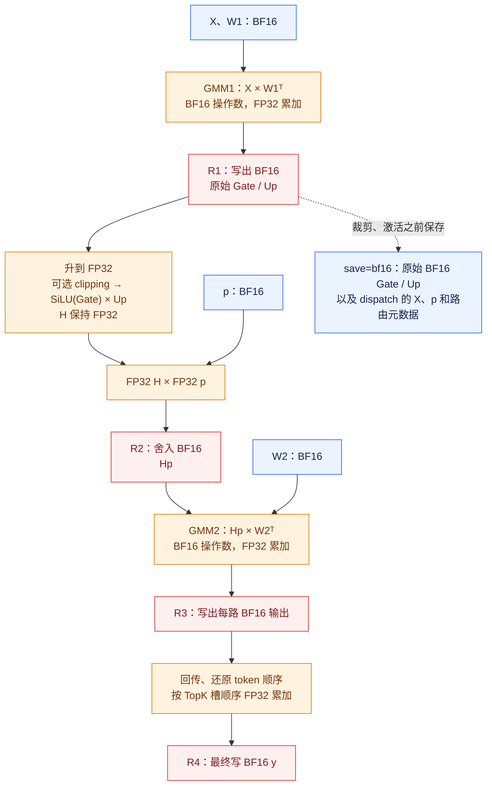
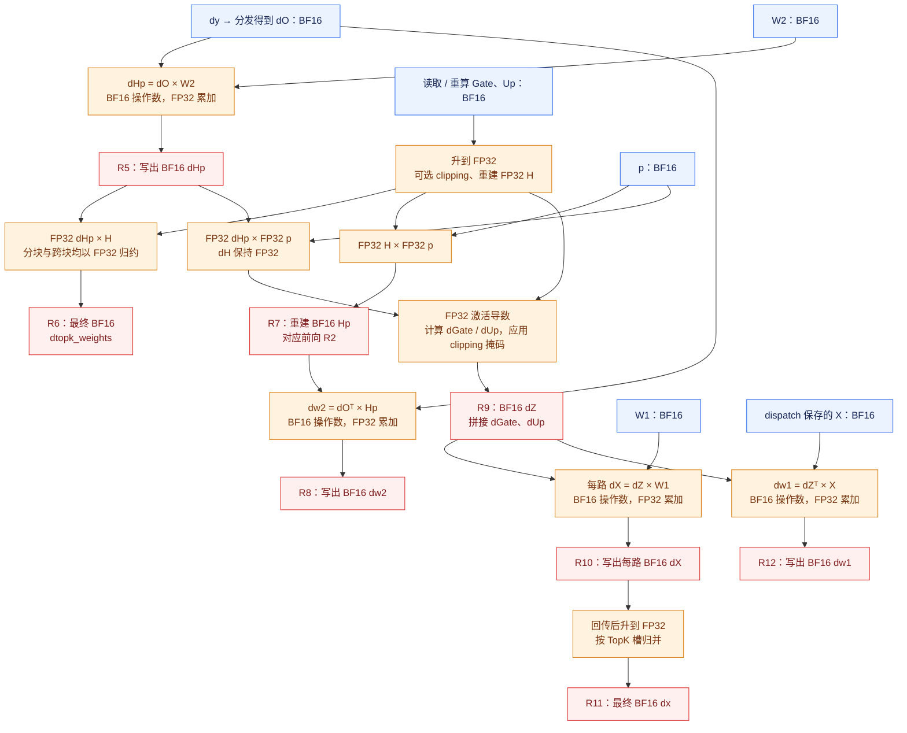

# MegaMoE BF16 训练精度流转

更新日期：2026-11-05。本文描述包含 PR18 FP32 H、dH 改动的实现，以
`save_gmm1_output="bf16"` 为主线。GMM1 仍先产生 BF16 Gate/Up；图按数据依赖组织，
实际 kernel 会融合、分块并重叠执行。

蓝色表示 BF16 张量，橙色表示 FP32 计算或累加，红色表示 FP32→BF16 的舍入边界。
虚线表示前向留给反向的数据。`D` 是 hidden size，`F` 是 SwiGLU 单路宽度，GMM1
输出为 `2F`；`H` 是未乘路由权重 `p` 的激活，`Hp` 是乘权后的激活。

## 前向：H 保持 FP32，写 Hp 时舍入



H 不先转 BF16 再乘 p；FP32 SiLU、乘 Up 和乘 p 连续计算，最后形成 BF16 Hp。
GMM1 的 Fixpipe 可以直接把 BF16 Gate/Up 交到 Vector 使用的 UB，调度变体也可经
GM 暂存。H 保留在寄存器中，不为它新增 FP32 UB/GM 平面。

## 反向：四项梯度的精度边界

`dO` 是原始 `dy` 按路由分发后的 BF16 梯度。反向重建与前向相同的 FP32 H，
供 `dtopk_weights` 和 BF16 Hp 重建使用。dH 也保持 FP32，直到写出 dGate/dUp。



矩阵公式使用公共布局 `W1=[E,2F,D]`、`W2=[E,D,F]`。兼容的转置权重布局改变
矩阵写出方向，不改变这里的 BF16/FP32 规则。完整 tile 和尾块采用相同数值边界，
partial 继续复用现有缓冲。

## 保存模式

| `save_gmm1_output` | 前向留给反向的 Gate/Up | 反向激活输入 |
| --- | --- | --- |
| `bf16`，默认 | 裁剪前的原始 BF16 Gate/Up | 读取后提升 FP32 |
| `none` | 保存 dispatch 输入和路由，不保存 Gate/Up | 重算 GMM1，得到 BF16 Gate/Up，再提升 FP32 |
| `mxfp8` | 压缩数据和 scale；开启 clipping 时另存原始裁剪决定 | 解码为 BF16 后提升 FP32，使用保存的裁剪决定 |
| `auto` | 关闭 clipping 选择 MXFP8，开启 clipping 选择 BF16 | 按实际模式处理 |

各模式的前向均从原始 BF16 Gate/Up 计算，MXFP8 压缩发生在反向保存/恢复路径。
因此压缩模式重建的 H 可以与未压缩前向不同。BF16/none 根据原始值判断 clipping
导数掩码；MXFP8 使用原始裁剪决定。`saved_state`、`dispatch_output` 的 Python
容器 dtype 为 `uint8`，内部浮点载荷类型由布局决定；IDs 和 counts 是整数。

## 计算契约

`R` 表示最近偶数舍入到 BF16。以下 g、u、p、dHp 均已提升到 FP32；按需先 clamp。

```text
silu = g / (1 + exp(-g))
H = silu * u                         # FP32
Hp = R(H * p)
dH = dHp * p                         # FP32
s = 1 / (1 + exp(-g))
dUp = R(dH * silu * up_mask)
dGate = R((dH * u) * (s * (1 + g * (1 - s))) * gate_mask)
dZ = (dGate, dUp)
dp_partial = sum_tile_FP32(dHp * H)
dp = R(sum_tiles_FP32(dp_partial))
```

H、dH 和 dp 乘积均不插入 BF16 中间舍入；Hp、dGate/dUp 仍写 BF16。clipping
边界点传递梯度，超界时对应导数为零。导数遵循融合浮点子图与 Cast 恒等梯度约定。

## 测试中的三种参考

统一入口为 [test_mega_moe.py](../tests/bf16/test_mega_moe.py)。三种参考使用同一份公共输入：

| 参考 | 作用 | 实现 |
| --- | --- | --- |
| MegaMoE 契约参考 | 混合容差检查；匹配本文 FP32 H/dH、BF16 Hp/dZ、FP32 Y/dX/dp 归约 | [npu_baseline.py](../tests/bf16/npu_baseline.py)，`reference="megamoe"` |
| FP32 边界 BigOp，`fp32-boundaries-v2` | ATK 的 NPU 小算子基线；与融合算子统一本文精度与舍入边界 | [npu_baseline.py](../tests/bf16/npu_baseline.py)，`reference="bigop"` |
| CPU FP64 真值 | 从公共输入建立数学前反向图，不插入 BF16 中间边界 | [cpu_reference.py](../tests/bf16/cpu_reference.py) |

BigOp 与契约参考共享 FP32 激活、导数和归并实现；BF16 保存时，两项检查复用同一份结果。
clipping 在 FP32 中进行，掩码依原始 Gate/Up 判断，边界值保留梯度。BF16 保存模式直接复用
前向原始 Gate/Up，save=none 才重算。最终 BF16 转换采用最近偶数舍入。公共数值规则适用于
所有已有保存模式，当前发布用例仍仅覆盖 BF16 保存。CPU FP64 真值和 ATK 门限不变，旧
BigOp 结果保留原版本标识。MXFP8 诊断重放采用同一份 MegaMoE 契约；测试
范围和具名历史结果见 [TEST_SPEC.md](../tests/bf16/TEST_SPEC.md)。

## 源码入口与回归例

| 步骤 | 源码 |
| --- | --- |
| GMM1/GMM2 操作数与输出 | [mega_moe_bf16_forward_catlass_impl.hpp](../csrc/kernels/bf16/catlass/mega_moe_bf16_forward_catlass_impl.hpp) |
| 前向 FP32 H、BF16 Hp，保存原始 Gate/Up | [block_epilogue_swiglu_forward_bf16.hpp](../csrc/kernels/bf16/epilogue/block_epilogue_swiglu_forward_bf16.hpp)：`ComputeSwigluDirect` |
| 前向 FP32 归并 Y | [mega_moe_unpermute.hpp](../csrc/kernels/bf16/routing/mega_moe_unpermute.hpp)：`TryUnpermute`、`UnpermuteByHiddenChunk` |
| dHp、dX、dw1、dw2 矩阵乘 | [mega_moe_bf16_backward_catlass_impl.hpp](../csrc/kernels/bf16/catlass/mega_moe_bf16_backward_catlass_impl.hpp) |
| H/Hp 重建、FP32 dH、dZ、dp partial | [block_epilogue_swiglu_backward_bf16.hpp](../csrc/kernels/bf16/epilogue/block_epilogue_swiglu_backward_bf16.hpp)：`ComputeFusedFullTile`、`ComputeForwardAux`、`ComputeSwigluGradImpl` |
| dX 归并、dp 归约与写回 | [mega_moe_bf16_backward.hpp](../csrc/kernels/bf16/mega_moe_bf16_backward.hpp)：`UnpermuteBackward`、`ReduceAndRouteTopkGrad` |
| 保存区与 autograd | [mega_moe_layout.hpp](../csrc/kernels/bf16/layout/mega_moe_layout.hpp)、[bf16.py](../python/deep_ep_experimental/megamoe_train/bf16.py) |

取 `g=1, u=1.3125, p=0.00099945068359375`，一次写出 Hp 得到
`0.000957489013671875`，提前舍入 H 后再乘 p 得到 `0.0009613037109375`。
取 `dHp=0.75, p=0.10009765625`，保持 FP32 dH 时 dGate 为 `0.09130859375`，
提前舍入 dH 则为 `0.091796875`。这些边界回归已迁到
[test_reference_contract.py](../tests/bf16/test_reference_contract.py)，不再依赖退休的分立 golden。
