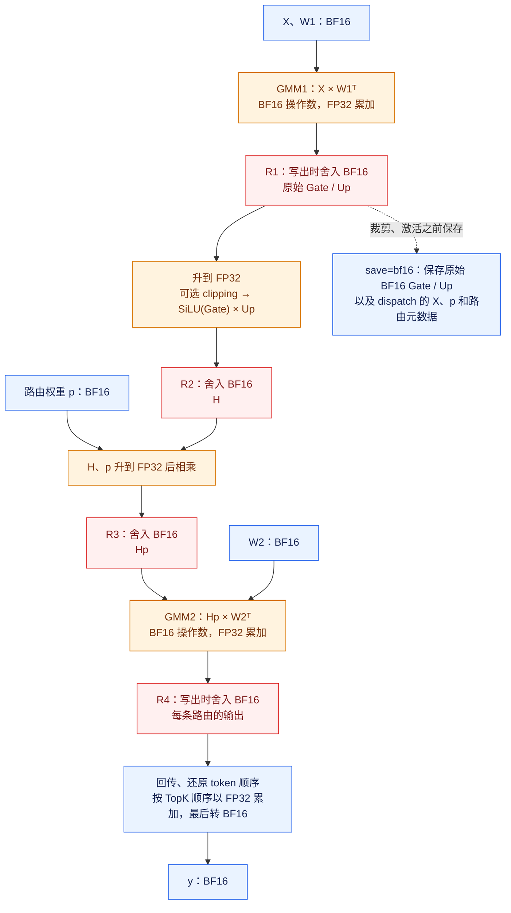
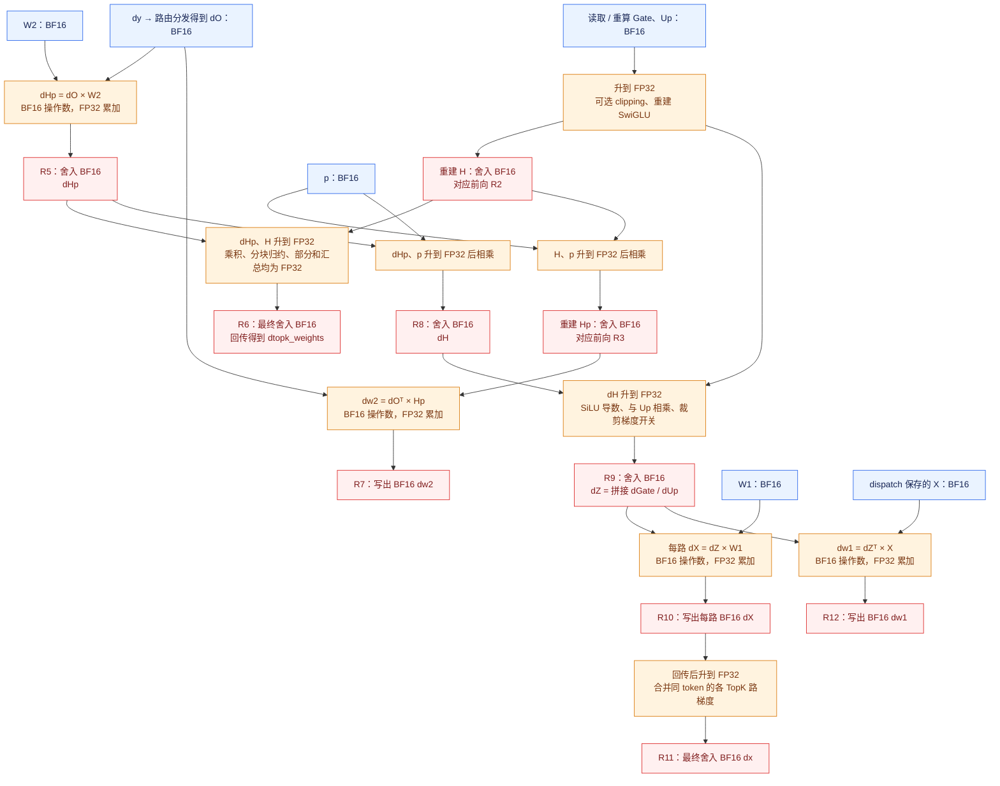

# MegaMoE BF16 训练精度流转

更新日期：2026-11-05。下图描述当前目标分支实现（基于 `6760b83`），以默认
`save_gmm1_output="bf16"` 为主线；尚未包含讨论中的 GMM1 FP32 结果直接进入
SwiGLU 的改进方案。图按数据依赖组织，实际 kernel 会融合、分块并重叠执行。

读图约定：蓝色表示 BF16 张量，橙色表示 FP32 计算或累加，红色表示
FP32 → BF16 的舍入边界；虚线表示前向留给反向的数据。BF16 → FP32 的转换
能让后续计算使用更高精度，但不能恢复此前 BF16 舍入丢失的信息。

符号：`D` 是输入 hidden size，`F` 是 SwiGLU 单路宽度，GMM1 输出宽度为 `2F`；
`p` 是每条 token/expert 路由的 TopK 权重。`H` 表示未乘 `p` 的 SwiGLU 输出，
`Hp` 表示乘权后的输出。图中的矩阵运算按单个专家书写，`X`、`dO` 均已按路由分发。

## 前向：BF16 输入在哪里升精度、在哪里再次舍入



这里有两个容易漏看的边界：GMM1 虽然在 FP32 中累加，交给激活的 Gate/Up
已经是 BF16；SwiGLU 内部没有单独的 BF16 SiLU 张量，但 `H` 会先舍入一次，
之后乘 `p` 得到 `Hp` 时再舍入一次。当前前向 y 与反向 dx 都将各路 BF16 值转换为 FP32 累加，
最后一次转回 BF16，不在每次 TopK 加法后舍入。

当前融合主路径的 GMM1 结果通过 Fixpipe 进入 Vector 使用的 UB，并非所有结果都
先写到显存；调度变体也可能经 GM 暂存。图中的“写出”标注数值类型边界，不代表
每个节点都分配一个独立的显存张量。`H` 也可能只在寄存器/UB 中短暂存在。

## 反向：五项梯度分别经过哪些精度边界

`dO` 是 `dy` 按前向路由分发给专家后的 BF16 梯度。反向从保存或重算的 Gate/Up
重建 `H` 和 `Hp`，供 `dtopk_weights` 和 `dw2` 使用。



`dtopk_weights` 当前已经使用 FP32 逐元素乘积与 FP32 归约，最终才转 BF16；
但参与点积的 `H` 和 `dHp` 之前都经过 BF16 舍入。`dH = dHp * p` 也有独立的
BF16 边界，随后激活反向内部才重新升到 FP32。

权重梯度图使用公共布局 `W1=[E,2F,D]`、`W2=[E,D,F]`，所以写为
`dw1=dZᵀ×X`、`dw2=dOᵀ×Hp`；兼容的转置权重布局改变矩阵的写出方向，不改变
这里标出的 BF16/FP32 边界。

## 保存模式：影响反向读到的 Gate / Up

三种显式保存模式的前向激活都从原始 BF16 Gate/Up 计算。

| `save_gmm1_output` | 前向留给反向的 Gate/Up | 反向进入 FP32 激活计算之前 |
| --- | --- | --- |
| `bf16`，默认 | 裁剪之前的 BF16 Gate/Up | 读取 BF16，再转 FP32 |
| `none` | 不保存 Gate/Up；仍保留 dispatch 输入和路由等必要状态 | 重算 GMM1：BF16 操作数、FP32 累加，再写出 BF16 Gate/Up |
| `mxfp8` | BF16 Gate/Up 进一步压缩为 MXFP8 数据和 scale；开启裁剪时另存原始裁剪决定 | 解码到 BF16，再转 FP32；裁剪梯度使用保存的决定 |
| `auto` | 根据归一化后的 `swiglu_limit` 选择：关闭裁剪为 MXFP8，开启裁剪为 BF16 | 按实际选择的模式处理 |

因此 `auto` 不总是 BF16。MXFP8 增加的是反向保存/恢复路径上的有损边界，前向
不会先量化再计算激活。BF16/none 模式根据原始 BF16 Gate/Up 与 FP32 limit
判断裁剪梯度开关；MXFP8 模式保存原始决定，避免仅由解码值重新判断。

`saved_state`、`dispatch_output` 在 Python 层是 `uint8` 字节容器；其内部保存的
浮点载荷类型由上述布局决定，不能据容器 dtype 判断计算精度。
`topk_ids` 与 `counts` 是整数，不经过这些浮点精度转换。

## 对照代码的阅读入口

| 图中步骤 | 代码入口 |
| --- | --- |
| GMM1/GMM2 的 BF16 操作数与输出路径 | [mega_moe_bf16_forward_catlass_impl.hpp](../csrc/kernels/bf16/catlass/mega_moe_bf16_forward_catlass_impl.hpp) |
| R1 → clipping/SwiGLU → R2 → 乘 p → R3；保存原始 Gate/Up | [block_epilogue_swiglu_forward_bf16.hpp](../csrc/kernels/bf16/epilogue/block_epilogue_swiglu_forward_bf16.hpp)：`ComputeSwigluDirect` |
| 前向 TopK 的 FP32 合并与最终 BF16 写回 | [mega_moe_unpermute.hpp](../csrc/kernels/bf16/routing/mega_moe_unpermute.hpp)：`TryUnpermute`、`UnpermuteByHiddenChunk` |
| dHp、dX、dw1、dw2 的矩阵乘路径 | [mega_moe_bf16_backward_catlass_impl.hpp](../csrc/kernels/bf16/catlass/mega_moe_bf16_backward_catlass_impl.hpp) |
| H/Hp 重建、dH 舍入、激活反向、FP32 dp 部分和 | [block_epilogue_swiglu_backward_bf16.hpp](../csrc/kernels/bf16/epilogue/block_epilogue_swiglu_backward_bf16.hpp)：`SwiGLUGrad`、`ComputeForwardAux`、`ComputeDpPartials`、`ComputeSwigluGradImpl`、`ComputeFusedFullTile` |
| dx 的 FP32 合并、dp 的最终归约和 BF16 回写 | [mega_moe_bf16_backward.hpp](../csrc/kernels/bf16/mega_moe_bf16_backward.hpp)：`UnpermuteBackward`、`ReduceAndRouteTopkGrad` |
| 保存区布局 / Autograd 持有的状态 | [mega_moe_layout.hpp](../csrc/kernels/bf16/layout/mega_moe_layout.hpp)、[bf16.py](../python/deep_ep_experimental/megamoe_train/bf16.py) |

## 计算契约

`R`表示舍入到BF16。前向一直使用：

```text
g = FP32(gate_BF16)，u = FP32(up_BF16)
按需clamp g、u
silu = g / (1 + exp(-g))             # FP32
H  = R(silu * u)
Hp = R(FP32(H) * FP32(p_BF16))
```

修改前，反向重建H却使用`R(R(silu)*u)`；dUp使用BF16舍入后的SiLU，dGate先把`dH*u`物化为BF16，再计算SiLU导数。这在复刻`F.silu(BF16 gate)*BF16 up`的独立小算子图，与当前前向融合FP32 SiLU/Up的中间量边界不同。

当前反向与前向采用一致的中间量边界：

```text
H  = R(silu * u)
Hp = R(FP32(H) * p)
dH = R(dHp * p)                     # 保留乘权后的BF16张量边界
s  = 1 / (1 + exp(-g))              # FP32
dUp   = R(FP32(dH) * silu * up_mask)
dGate = R((FP32(dH) * u) * (s * (1 + g * (1 - s))) * gate_mask)
```

中间`SiLU`及`dH*u`不再先BF16舍入再转回FP32；最终H、Hp、dH、dGate/dUp仍分别保留原来的BF16边界。这里均为BF16，不是FP16；两版的实际向量乘法本来都是FP32，变化是是否插入中间BF16舍入。

覆盖`ComputeForwardAux`（尾块H）、`ComputeFusedFullTile`（满tile H及导数）、`ComputeSwigluGradImpl`（尾块导数），并同步清理`ComputeSwigluRecompute`的同类旧舍入。后者当前没有调用点，保持其契约一致，未新增调用。

统一测试中的 NPU 小算子参考显式保留 H、Hp、dH 和 dZ 的 BF16 边界；CPU FP64 数学真值独立计算，不插入这些舍入。完整精度以混合容差和 ATK 双标杆共同验收。

路由权重梯度 `dtopk_weights` 使用前向 BF16 H 和 GMM2 反向的 BF16 dHp，但逐元素乘积不再物化为 BF16：

```text
dp_partial = sum_tile(FP32(dHp) * FP32(H))  # FP32
dp = R(sum_tiles(dp_partial))              # 最终输出 BF16
```

满 tile 直接归约 FP32 乘积寄存器；尾块读取 BF16 操作数，在寄存器中转 FP32 相乘和归约。部分和继续复用原来的 UB/GM 布局，P6 汇总与最终 BF16 回写保持不变。NPU 契约参考同步该边界；原 BF16 BigOp、CPU FP64 真值及 ATK 门限保持不变。

此修改由 e32 同输入诊断对照支持：保留捕获的 NPU 操作数、用 FP32 乘积求和并最终转 BF16，rank 0 的 ATK 平均相对误差比例从 1.55253345 降至 1.33210788，两 rank 该项通过。该对照用于解释修改动机；融合内核的最终精度以对应构建产物的 ATK 回归为准。消除一处舍入不保证所有输入的最终误差单调改善。

## 保留的行为

- 前向代码、TopK早乘位置、GMM和Dispatch调度不变。
- GM/UB布局、workspace大小、Host ABI、ready协议、同步不变。
- clamp数值及导数掩码保持；边界点仍按原规则传递梯度，越界为零。
- dTopK使用FP32乘积和partial，保留原分块归约顺序及最终BF16输出。
- saved-none、bf16、mxfp8共用该反向epilogue；MXFP8仍因Gate/Up压缩而有独立误差，不能称其H与未压缩前向逐位一致。
- 此变更不把完整算法改成后乘p的外部fused计算图，也不保证与其逐位一致。

## 为什么这样处理导数

导数按当前融合FP32子图计算，在既有BF16张量边界处收口，遵循通常的浮点Cast恒等梯度约定。这里不是对离散BF16舍入函数求严格数学导数，也不能对包含BF16台阶的整体函数直接做微小有限差分。

CPU回归对平滑的内部SiLU/Up子图做有限差分，并单独检查clamp掩码及BF16边界。`g=1, u=1.3125`回归例确认重建H使用`0.9609375`，而非旧路径的`0.95703125`。

同样取`g=1, u=1.3125, p=1`，`dHp=0.28125`时dUp由旧舍入路径的`0.205078125`变为`0.2060546875`；`dHp=0.40625`时dGate由`0.4921875`变为`0.494140625`。新值与平滑子图的标量导数舍入结果一致。这是CPU舍入回归例，不是网络误差统计或loss改善证明。
