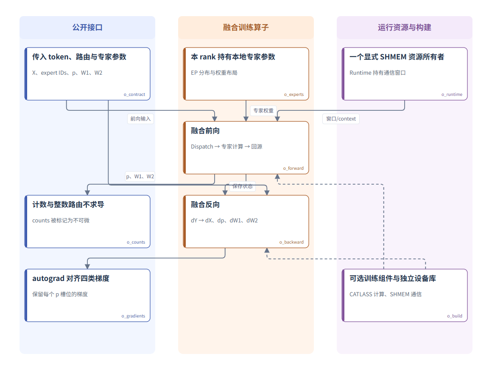
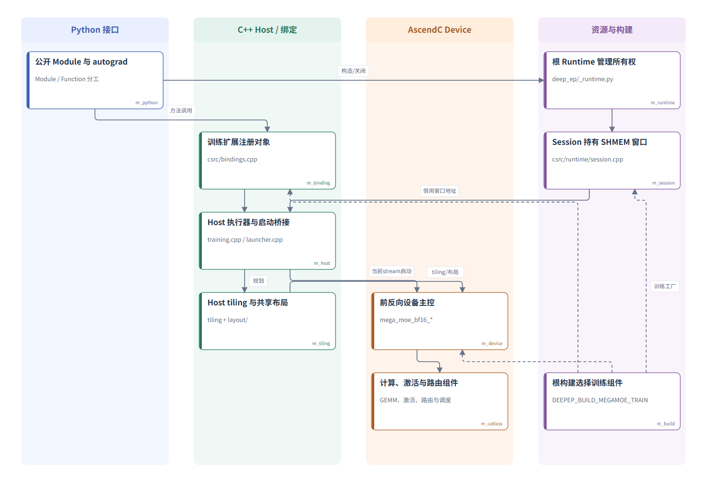
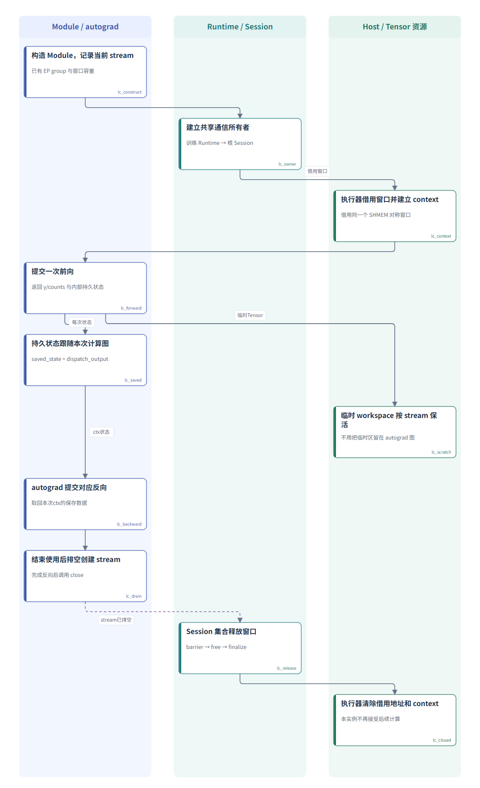
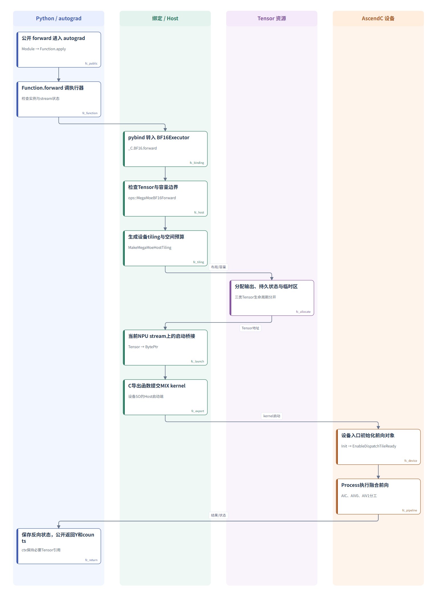
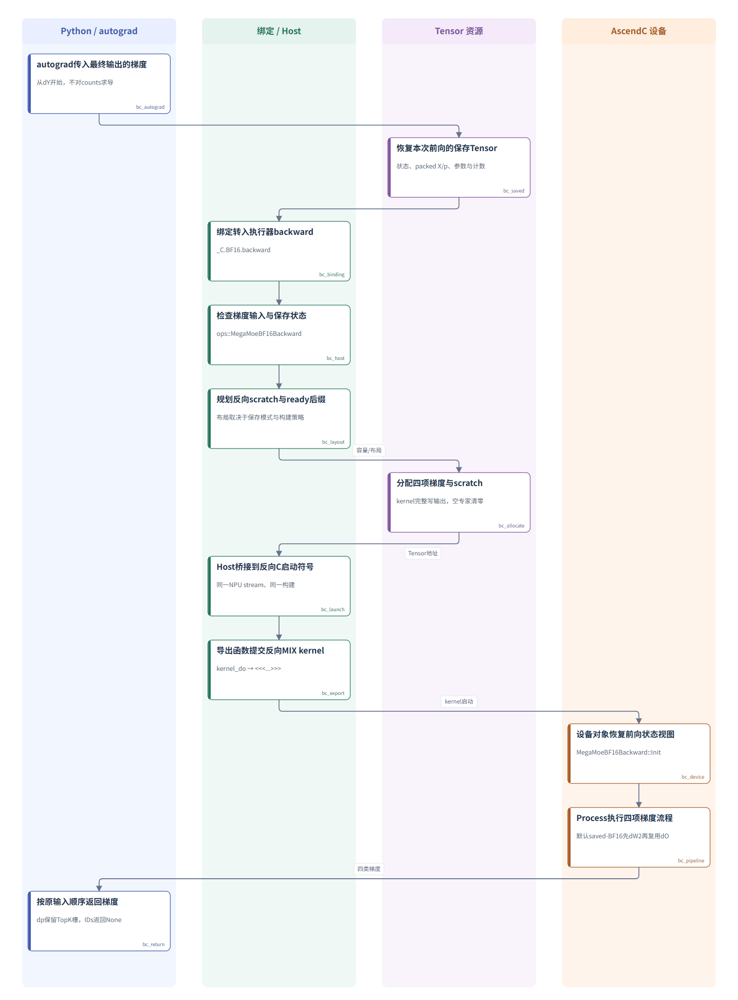
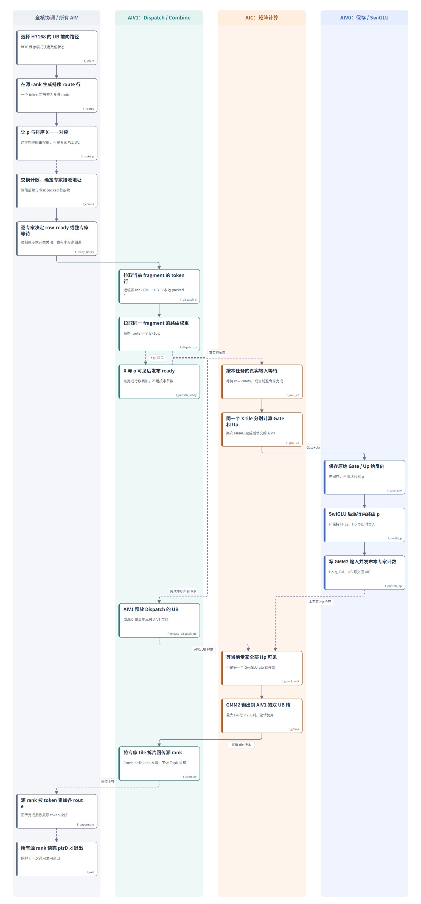
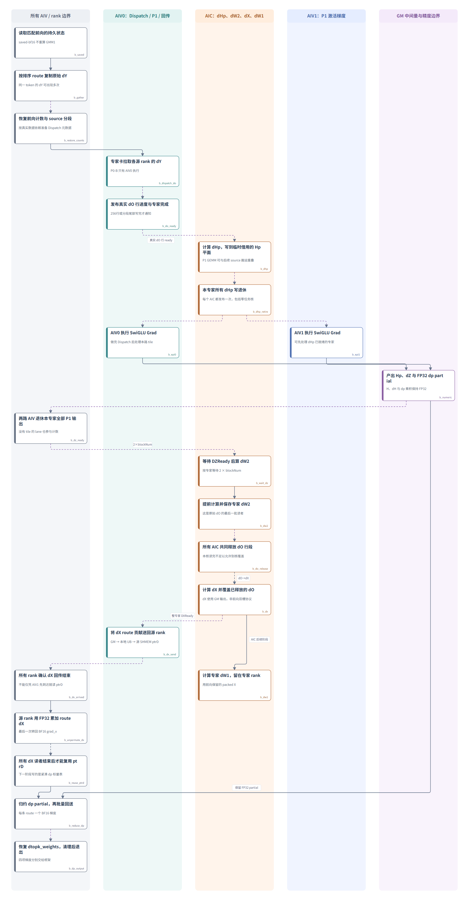
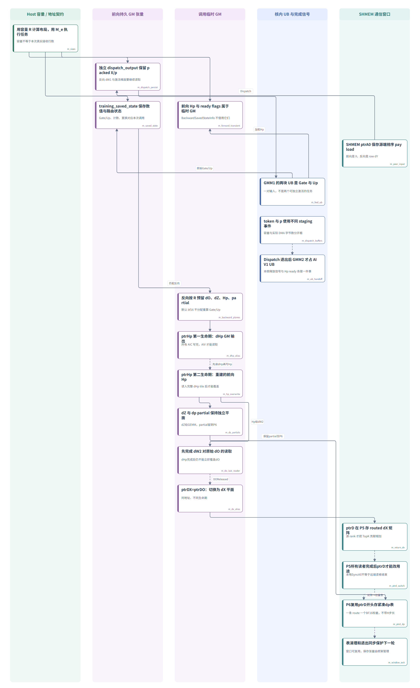

# MegaMoE BF16 训练源码图解

按项目结构、调用链、三核流水和内存复用逐层阅读。默认场景为 Ascend950、save=bf16、H3584/F3072、关闭 clipping。

源码快照：[29c1659](https://github.com/xixing-321/DeepEP/tree/29c16596004c871036ec781f96d4ba442c8497e1)。

[离线交互页面](index.html) · [完整调用点与源码](CALLPOINTS.md) · [维护方法](MAINTAINING.md)

[在线交互导览](https://xixing-321.github.io/DeepEP/)

**VS Code 一键定位**：按[扩展安装说明](vscode/README.md)安装一次，运行 **MegaMoE: 打开训练源码导览**。点击图内节点，即可在旁边的编辑器中查看对应文件和行号；多处来源可在详情中分别打开。

[下载 VS Code 导览扩展](https://xixing-321.github.io/DeepEP/downloads/megamoe-train-source-guide.vsix)

本地用浏览器打开 index.html，即可点击节点查看读写、等待和带行号源码。仓库网页可以直接阅读下方图文，通过调用点表跳转源码。

普通浏览器保留 **复制定位路径**：按 **Ctrl+P** 粘贴并回车，打开对应源码和行号。

## L1 · MegaMoE BF16 训练做什么

一个融合训练算子完成路由专家的前向与反向；调用方提供路由和专家参数，算子返回输出、计数以及四类梯度。

[查看矢量图](diagrams/00-overview.svg) · [查看图源](diagrams/00-overview.mmd) · [本节调用点](CALLPOINTS.md#00-overview)

## L2 · 模块关系与构建边界

Python 协调 autograd，Host 分配与启动，Device 执行融合流程；Runtime 管理通信资源，构建依赖与运行调用分开表示。

[查看矢量图](diagrams/01-modules.svg) · [查看图源](diagrams/01-modules.mmd) · [本节调用点](CALLPOINTS.md#01-modules)

## L3 · 一次前后向与资源生命周期

通信窗口属于模块生命周期，saved Tensor 属于每次 autograd 图，临时 workspace 属于一次设备调用；关闭发生在反向完成之后。

[查看矢量图](diagrams/02-lifecycle.svg) · [查看图源](diagrams/02-lifecycle.mmd) · [本节调用点](CALLPOINTS.md#02-lifecycle)

## L4 · 一次前向的跨文件调用

从Module调用逐层走到MIX设备入口，再沿保存结果返回autograd；箭头表达调用或数据关系，stage坐标不代表实测耗时。

[查看矢量图](diagrams/03-forward-call.svg) · [查看图源](diagrams/03-forward-call.mmd) · [本节调用点](CALLPOINTS.md#03-forward-call)

## L4 · 一次反向的跨文件调用

autograd将dY与前向状态送入Host反向入口；Host规划scratch并提交同一套设备库，设备计算完成的数据依赖由stream和kernel内部同步保证。

[查看矢量图](diagrams/04-backward-call.svg) · [查看图源](diagrams/04-backward-call.mmd) · [本节调用点](CALLPOINTS.md#04-backward-call)

## L5 · 前向：Dispatch、GMM1、SwiGLU、GMM2 与回传

沿普通 BF16、H3584、F3072、saved-bf16、clipping 关闭的路径阅读。纵向表示源码阶段和依赖，不是耗时比例；不同核可以处于不同阶段。X/p 就绪、专家 SwiGLU 完成、UB 槽可复用是三种不同条件。

[查看矢量图](diagrams/05-forward-kernel.svg) · [查看图源](diagrams/05-forward-kernel.mmd) · [本节调用点](CALLPOINTS.md#05-forward-kernel)

## L5 · 反向：从原始 dY 到四项梯度

固定 saved-bf16 与 canonical 权重。P0 发送原始 dY，P1 的 dHp/Hp 共用 GM，默认路径先等本专家 dHp 计算退休再由两路 AIV 分领 tile。dW2 实际提前到 dX 之前；阶段编号来自源码，不代表最终执行顺序或耗时。

[查看矢量图](diagrams/06-backward-kernel.svg) · [查看图源](diagrams/06-backward-kernel.mmd) · [本节调用点](CALLPOINTS.md#06-backward-kernel)

## L5 · 内存与生命周期：哪些保存，哪些复用

按一次前向及匹配反向追踪内存。R 是预留接收容量，M_e 是当前专家实际行数；SHMEM窗口、持久状态、调用临时GM、核内UB有不同所有者。复用成立依赖生产者和所有读者退休，不能仅凭两个指针相同或本核执行完判断安全。

[查看矢量图](diagrams/07-memory.svg) · [查看图源](diagrams/07-memory.mmd) · [本节调用点](CALLPOINTS.md#07-memory)
